# Music Streaming Analytics

A distributed, event-driven analytics platform for real-time music play tracking.
Built to explore stream processing, distributed state management, and cloud-native deployment patterns.

## Architecture



Three microservices communicating via Kafka:

- **ingestion-service**: HTTP API for clients to report play events, publishes to Kafka
- **stream-processor**: Kafka Streams application, computes windowed aggregations (completion rate, top songs)
- **query-service**: Consumes aggregation results, serves the latest values from Redis and per-window history from PostgreSQL

## Demo

A single command starts the stack, injects a Zipf-skewed "hot songs" workload, and
verifies that the query API returns exactly what was injected:

```bash
./scripts/demo.sh
```

If a running stack is detected on ports 8080 and 8082 it is reused — this covers both a
local docker-compose setup and a minikube `kubectl port-forward`. Otherwise the script
starts the dependencies and the three services itself.

The run ends with a per-track comparison against the expectations the generator recorded
at injection time:

```
track               starts  completes     rate  expected   ADR 003 threshold: 90%
neon-skyline           179        158   88.3%    88.3%   OK
paper-boats             58         55   94.8%    94.8%   OK
static-bloom            58         29   50.0%    50.0%   OK
...
OK All 12 tracks match the expected starts / completes exactly.
   The end-to-end path (HTTP -> Kafka -> Kafka Streams windowed aggregation ->
   Kafka -> Redis -> query API) computes correct results.
```

The generator sets each track's popularity and its completion propensity independently,
so the most-played track is not the one with the highest completion rate. That contrast
is the point the demo is designed to illustrate, and it is the reasoning behind
[ADR 003](docs/decisions/003-completion-rate-definition.md).

**[DEMO.md](DEMO.md)** documents how to read the output, how the two window sizes
(5 minutes for completion rate, 1 hour for the ranking) affect repeated runs, and the
known limitations the demo exposes.

## Tech Stack

- **Language**: Kotlin, JDK 21
- **Framework**: Spring Boot (stream-processor / query-service on 3.5.x, ingestion-service on 3.3.5)
- **Stream Processing**: Kafka Streams
- **Storage**: Redis (latest-window read model) and PostgreSQL (per-window history archive, schema managed by Flyway) — see [ADR 004](docs/decisions/004-query-architecture-cqrs.md).
- **Deployment**: Docker, Kubernetes (minikube for dev, GKE planned)
- **CI**: GitHub Actions

## Key Design Decisions

See [docs/decisions/](docs/decisions/) for ADRs on:
- [001](docs/decisions/001-kafka-internal-topic-rf.md) — Kafka internal topic replication under a single-broker setup
- [002](docs/decisions/002-kafka-advertised-listeners-and-dev-loop.md) — Advertised listeners and local dev loop trade-offs
- [003](docs/decisions/003-completion-rate-definition.md) — Completion rate business definition (90% threshold)
- [004](docs/decisions/004-query-architecture-cqrs.md) — CQRS-style query architecture (Kafka → Redis, decoupled from stream-processor state)
- [005](docs/decisions/005-kafka-streams-changelog-partition-mismatch.md) — Kafka Streams changelog partition mismatch blocking consumer group registration
- [006](docs/decisions/006-grafana-hidden-variable-no-data.md) — Grafana hidden variables and exact matching causing No data
- [007](docs/decisions/007-failure-recovery-observations.md) — Load test and failure drill observations

## Performance & Failure Drills

Throughput, latency, failure recovery and backpressure results are in
[docs/performance.md](docs/performance.md), with raw k6 output and lag traces under
`docs/observability/perf-results/`.

## Quick Start

Prerequisites: Docker, JDK 21. `./scripts/demo.sh` performs the whole sequence below
automatically; run the steps manually when the services are needed in the foreground.

```bash
# Start Kafka, PostgreSQL, Redis, Prometheus, Grafana
docker compose -f docker-compose.dev.yml up -d

# Run each service (in separate terminals, from project root)
./gradlew :ingestion-service:bootRun
./gradlew :stream-processor:bootRun
./gradlew :query-service:bootRun

# Send test events
./scripts/test-data.sh

# Query results (latest window, from Redis)
curl http://localhost:8082/api/songs/song-A/completion
curl "http://localhost:8082/api/songs/top?n=5"

# Per-window history (from PostgreSQL); from/to are epoch millis, default last 24h
curl "http://localhost:8082/api/songs/song-A/completion/history"
curl "http://localhost:8082/api/songs/song-A/plays/history?from=1717600000000&to=1717700000000"
```

## Running on Kubernetes

Prerequisites: minikube, kubectl

```bash
# Point the shell at minikube's internal Docker daemon (repeat in every new terminal)
eval $(minikube docker-env)

# Build the three service images
docker build -t ingestion-service:v1 -f services/ingestion-service/Dockerfile .
docker build -t stream-processor:v1 -f services/stream-processor/Dockerfile .
docker build -t query-service:v1 -f services/query-service/Dockerfile .

# query-service reads the PostgreSQL password from a Secret in its own namespace;
# copy it from the Helm-generated Secret in `data` (Secrets cannot be referenced across namespaces)
kubectl create secret generic postgres-credentials \
  --from-literal=postgres-password="$(kubectl get secret postgres-postgresql -n data -o jsonpath='{.data.postgres-password}' | base64 -d)"

# Deploy
kubectl apply -f k8s/ingestion-service.yaml
kubectl apply -f k8s/stream-processor.yaml
kubectl apply -f k8s/query-service.yaml

kubectl get pods -w

# Access from the host
kubectl port-forward svc/ingestion-service 8080:8080 &
kubectl port-forward svc/query-service 8082:8082 &

./scripts/demo.sh --skip-infra
```

Kafka (`kafka` namespace), Redis and PostgreSQL (both in `data`) are installed via Helm.
Their values are checked in as `k8s/kafka-values.yaml`, `k8s/redis-values.yaml` and
`k8s/postgres-values.yaml` (the PostgreSQL password is deliberately left out of the file
and passed with `--set auth.postgresPassword=...` on upgrade). `docker-compose.dev.yml`
is retained for local development that does not need K8s.

## Scripts

| Script | Purpose |
|---|---|
| `demo.sh` | One-command demo: starts the stack, injects skewed traffic, verifies results ([DEMO.md](DEMO.md)) |
| `demo-traffic.py` | Zipf-skewed play-event generator; records the expected aggregates for verification |
| `demo-report.py` | Queries the API and compares the results against those expectations |
| `test-data.sh` | Minimal fixture: 10 starts and 8 completes for a single track |
| `test-late.sh` | Exercises the 1-minute grace period on the 5-minute window |
| `test-metrics.sh` | Asserts that the Prometheus endpoints and business counters behave correctly |
| `load-test.js` | k6 load profile used to produce the results in `docs/performance.md` |
| `load-test.sh` | Low-rate curl loop, used to make Grafana `rate()` panels show visible movement |

`test-late.sh` sends one late event that should still be aggregated into the original
window and one beyond the grace period that should be dropped. It only emits the events;
consult the stream-processor log to confirm the outcome.

All demo script output is in English. The ADRs and the documents under `docs/` are
bilingual: each file opens with the English version, followed by the Chinese original.
Comments inside the scripts follow the repository convention and remain in Chinese.

## Ports

| Service | Port |
|---|---|
| ingestion-service | 8080 |
| stream-processor | 8081 |
| query-service | 8082 |
| PostgreSQL | 5432 |
| Redis | 6379 |
| Kafka | 9092 |
| Prometheus | 9090 |
| Grafana | 3000 |